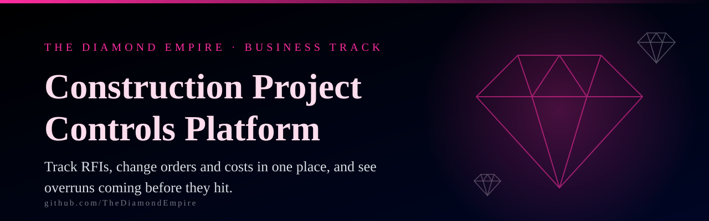
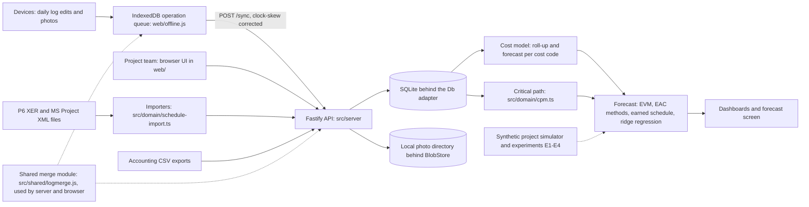

<p align="center"></p>

<p align="center">
  
  
  
</p>

# Construction Project Controls Platform

> Track RFIs, change orders and costs in one place, and see overruns coming before they hit.

A project-controls platform for general contractors and owner’s representatives. It connects RFIs, submittals, change orders, budgets, schedules and field logs, and forecasts cost and schedule at completion so teams can act while there is still room to recover. **This repository is a working local prototype:** it runs on one machine on synthetic data and has never been used on a real project. Its calculations and forecasts are planning aids, not engineering, legal or safety advice, and nothing here claims anything about real construction outcomes.

**Quick links:** [Architecture](#architecture) · [Tech stack](#tech-stack) · [Engineering decisions](#engineering-decisions) · [Roadmap](#roadmap) · [Getting started](#getting-started) · [Case study](docs/case-study.md) · [Research report](docs/research-report.md) · [Quality report](docs/quality-report.md) · [Worked examples](docs/worked-examples.md)

> **Public showcase.** This repository holds the documentation, client case study, research report and measured results for this product. The runnable source code is distributed separately under a license: see [SOURCE-ACCESS.md](SOURCE-ACCESS.md).

## At a glance

|  |  |
|---|---|
| **Track** | Business · Advanced |
| **Phase** | Beta: all five milestones are built and tested, and the tests, checks and measurements were run from a clean short-path copy with recorded results. It is a local prototype on synthetic data: not deployed, not used on a real project, no real-world schedule files tested, PostgreSQL and Docker not used. |
| **Seller** | The Diamond Empire (https://thedempire.shop/) |
| **Primary reader** | Clients and founders |
| **Read next** | [README](README.md) · [Client case study](docs/case-study.md) · [Research report](docs/research-report.md) · [Quality report](docs/quality-report.md) |

## Why this exists

Construction projects run on spreadsheets, email and PDFs. Change orders sit unapproved while work proceeds, budgets are reconciled monthly and too late, and by the time cost overruns are visible the money is spent.

## What it does (all of this is built and tested)

- **M1: projects, cost codes, budgets and commitments.** Companies (owner, contractor, subcontractor), users and role-based access per project (project manager, engineer, superintendent, owner representative, subcontractor, viewer). One cost-code tree; an append-only budget ledger (original budget, transfers that sum to zero, approved changes); subcontracts and purchase orders with lines and adjustments; actual costs; CSV import of budgets and of accounting actuals with a dry run, per-line rejection reasons and idempotent re-import; a cost report that rolls up by plain summation and shows, for every cost code, how its forecast was built.
- **M2: RFIs and submittals.** State machines with ball-in-court (only the party holding the ball can answer), business-day due dates, revisions for resubmittals, an event history, an aging report (0-7, 8-14, 15-30, 31+ days, overdue counts, by company) and median response time. Subcontractors see only items they created or hold the ball for.
- **M3: change orders and pay applications.** Pipeline potential, pricing, submitted, approved, rejected, void, with cost lines by cost code and schedule days. Unapproved change orders are weighted exposure in the forecast immediately; approval posts to the budget (owner-directed changes), to a linked commitment (subcontract changes) and to project time. Pay-application preparation on a schedule of values with retainage, separate retainage on stored materials, carry-forward of stored balances, validation against overbilling and a draft, submitted, certified, paid flow where certification is the owner side's permission.
- **M4: offline-capable daily logs.** Weather, notes, manpower and photos recorded in the browser into an IndexedDB queue, a service worker so the app opens with the server unreachable, sync when the connection returns, a merge that converges whatever order devices sync in, and correction for device clocks that are wrong.
- **M5: schedule import, earned value and forecasting.** Primavera P6 XER and Microsoft Project XML import (activities, durations, progress, FS/SS/FF/SF with lags); critical path, total and free float, and risk flags (critical, near critical, negative float against the required finish, open ends, long lags, long durations, out of sequence, behind the data date); earned-value metrics; four EAC methods (budget at completion, CPI-based, atypical variance, CPI x SPI) plus a bottom-up estimate by cost code and an optional ridge-regression estimate calibrated on completed-project history; earned-schedule finish forecast against the traditional SPI formula; every estimate shows its formula and its drivers.
- **Synthetic experiments E1 to E4** on forecast accuracy with a seeded project simulator, run by one command, results in [results/](results/) and written up in the [research report](docs/research-report.md).

## Not built yet / out of scope

| Item | Why |
|---|---|
| Next.js | The interface is a hand-written single-page app (vanilla JavaScript modules, no build step, no framework, no external assets); there was no need for a framework in a prototype and it keeps the dependency list to one package. |
| Python forecasting service | Python was not installed. The earned-value, earned-schedule and ridge-regression code is TypeScript in `src/domain`. No scikit-learn or other model library was used. |
| PostgreSQL | SQLite through `node:sqlite` was used. The SQL is SQLite-flavoured and the database interface is synchronous, so a PostgreSQL adapter would need an async variant. PostgreSQL and MySQL were never tested. |
| S3-compatible storage | Photos are stored in a local directory behind a small `BlobStore` interface; no network storage was run. |
| Docker, Terraform, deployment | No working Docker was available; nothing is deployed anywhere. |
| Real data and real schedule files | No real P6 or Microsoft Project exports and no real cost histories were available. The importers were tested on hand-written samples that follow the format layout, so fidelity on real files is unknown. |
| Calendars, holidays, constraints, resources, WBS in schedules | The schedule engine uses a five-day week, rounds durations up to whole days and ignores constraints and resources. The planned-value curve comes from a profile or points, not from a cost-loaded schedule. |
| Interface forms for some settings | Forecast overrides, schedule-of-values items, member management, change-order weights, project settings and regression calibration are available through the API only. |
| Retainage release, subcontractor pay applications, lien waivers, drawing and document management | Not built. Only photos are stored. |
| Authentication hardening | No rate limiting, multi-factor sign-in or password reset (see `SECURITY.md`). |
| Mobile-device testing | The PWA was tested in one desktop Chromium-based browser only; installing it on a phone, push notifications and other browsers were not tested. |
| Bottom-up method and commitment features in the experiments | The simulator has no cost-code structure; the bottom-up estimate exists in the product but is not evaluated. |
| Notifications, e-mail, accounting integrations | Only CSV import. Nothing is sent anywhere; there is no tracking, analytics or phone-home code. |

## Architecture



## Tech stack

| Layer | Technology actually used |
|---|---|
| Language, tooling | TypeScript run directly by Node.js 25 (type stripping, no build step), `tsc --noEmit` for type checking, `node:test`, fast-check for property tests |
| Web | Hand-written single-page app: vanilla JavaScript modules, CSS, a service worker and a web manifest; IndexedDB for the offline queue; no framework and no external assets |
| API | Node.js and Fastify 5; bearer-token sessions; role-based access per project; Content-Security-Policy and other headers |
| Data | SQLite through the built-in `node:sqlite` behind a small `Db` interface; photos in a local directory behind `BlobStore` |
| Forecasting | TypeScript: earned-value metrics, EAC formulas, earned schedule, ridge regression (normal equations); a seeded project simulator for experiments |
| Imports | XER parser, Microsoft Project XML reader (own minimal XML parser, no DTD or entity support), CSV parser |
| Checks | playwright-core driving the installed Chromium-based browser, axe-core (development only), scripts for contrast, licences, asset weight and path scanning |
| CI | `.github/workflows/ci.yml` runs the same commands as below; **it has never been run** |

## Engineering decisions

### The cost model is the spine

RFIs, change orders and commitments all post to one cost-code structure. A potential change order is weighted exposure in the forecast before it is approved, and approval replaces the exposure with budget so nothing is counted twice. Parent codes hold no amounts: every summary is a plain sum of its children, which a property test checks on random trees.

### Offline first for the field

A daily log is a set of last-writer-wins registers (one per field, one per manpower or photo entry). Every operation carries a unique tag of timestamp, device and operation id, so applying operations is commutative, associative and idempotent, and any devices that have exchanged the same operations agree. Device clocks are not trusted: the server shifts a batch's timestamps by the difference between its own receive time and the device's send time, and never past the receive time. The same module runs in the browser and on the server.

### Forecasts show their reasoning

Each estimate at completion displays its method, formula and the numbers behind it, and each cost code explains how its forecast was built, so project managers can challenge it rather than blindly trust it. Change-order weights are illustrative defaults, not calibrated to data.

### Hand-computed checks before trust

The critical-path, earned-value, earned-schedule, retainage and roll-up calculations were each worked by hand first ([worked examples](docs/worked-examples.md)) and are asserted in tests, alongside property tests (for example the critical-path engine is compared with path enumeration on random networks).

## Quality bar

- Property-based tests for cost roll-ups (sums reconcile at every level of the cost structure), pay-application identities, critical-path floats and the convergence of the offline merge
- Offline sync conflict tests across devices and clock skew
- Import tests against hand-written XER and Microsoft Project XML samples (no real exports were available)
- Role and permission tests across owner, contractor and subcontractor boundaries, and across projects
- One real-browser test that goes offline, queues edits and photos, and syncs, and one that starts the app with the server stopped
- Test status and measurements: see [Verification](#verification) and the [quality report](docs/quality-report.md)

## Results at a glance (synthetic data; details and caveats in the [research report](docs/research-report.md))

All experiment data are **synthetic**, generated by the author's own simulator whose assumptions favour the regression in several ways; the results say how the methods behave on that model and nothing about real projects. Raw per-project rows are in `results/`.

<!-- table:verdicts -->
| Hypothesis | Verdict (synthetic data only) | Headline |
| --- | --- | --- |
| H1: regression cuts EAC error by at least 20% vs CPI at 30-70% complete | supported on this synthetic generator | reduction 43.5% to 45.4% across the five checkpoints |
| H2: pending change-order exposure cuts error materially in high-change projects | supported on this synthetic generator | high volume: 23.7% [21.22%, 26.15%] |
| H3: earned schedule beats the traditional SPI formula in the later half | supported on this synthetic generator | mean abs. finish error 5.2 to 12.2 days vs 9.8 to 21.1 days |
| H4: accuracy degrades gracefully with 1-4 weeks of reporting delay | not supported on this synthetic generator | MAPE ratio at 4 weeks: CPI-based 1.17, regression 2.04 (criterion: at most 1.5) |

Measured properties of the software (all from files in `results/`; the [quality report](docs/quality-report.md) says what each does and does not show):

<!-- table:measures -->
| Quantity | Value | Source file | Command |
| --- | --- | --- | --- |
| Colour pairs checked / below their minimum | 26 / 0 | `results/contrast.json` | `npm run check:contrast` |
| Tightest pair (ratio against its minimum) | --field-border on --surface: 3.65 against 3 | `results/contrast.json` | `npm run check:contrast` |
| Production packages (transitive) / outside the licence allow-list | 49 / 0 | `results/licenses.json` | `npm run check:licenses` |
| Static files served, total bytes (gzip) | 13 files, 82667 (29177) | `results/web-weight.json` | `npm run check:weight` |
| First load of the signed-out screen: requests, response body bytes, all same-origin | 11, 81003, true | `results/first-load.json` | `npm run measure` |
| axe-core scans / violation instances | 22 / 0 | `results/a11y-axe.json` | `npm run measure` |
| Text files scanned / path, user-name or personal-name findings | 119 / 0 | `results/path-scan.json` | `npm run check:paths` |
| Steps of the one-shot run that exited 0 | 6 of 6 | `results/measurement_run.json` | `npm run measure` |

The accessibility scan is automated and partial: it is not a claim that the interface is accessible to any WCAG level.

## Roadmap

- [x] M1: projects, cost codes, budgets and commitments (`tests/api-cost.test.ts`, `tests/costs.test.ts`, `tests/api-access.test.ts`)
- [x] M2: RFI and submittal workflows with aging reports (`tests/api-workflow.test.ts`, `tests/workflow.test.ts`)
- [x] M3: change-order pipeline linked to the forecast, and pay applications (`tests/api-workflow.test.ts`, `tests/payapp.test.ts`)
- [x] M4: offline mobile daily logs (`tests/sync.test.ts`, `tests/api-field.test.ts`, `tests/ui.test.ts`)
- [x] M5: schedule import, earned-value metrics and forecasting (`tests/importers.test.ts`, `tests/cpm.test.ts`, `tests/evm.test.ts`, `tests/api-schedule.test.ts`, `tests/experiments.test.ts`)
- [ ] Not on the roadmap yet: real-world file and data validation, PostgreSQL and object storage, deployment, authentication hardening, interface forms for the API-only settings

## Getting started

> _These instructions refer to the source package, which is distributed separately and is not part of this showcase repository._

Requires Node.js 25 and npm (Node.js 24 should work but was not tried). Windows 11 with bash and PowerShell was used; verification was run from a short folder path because some tools struggle with very long Windows paths (no problem was observed here). These are the commands that were run, starting from a clean checkout:

```bash
npm ci                 # install exactly what package-lock.json says
npm start              # starts http://127.0.0.1:8787 ; on an empty ./data it loads SYNTHETIC demo data
```

Open http://127.0.0.1:8787 and sign in. Every demo account uses the password `demo-only-password` (local demo only; the server listens on 127.0.0.1):

| Account | Role |
|---|---|
| pm@example.test | contractor project manager (sees everything) |
| engineer@example.test | contractor engineer |
| super@example.test | superintendent (daily logs, RFIs, schedule; no cost) |
| owner@example.test | owner representative (certifies pay applications, approves change orders; no contractor budget) |
| concrete@example.test, electric@example.test | subcontractors (own commitments, own RFIs and submittals) |
| viewer@example.test | read-only |
| admin@example.test | administrator (creates companies, users and projects through the API; not a project member) |

Settings are optional environment variables, see `.env.example`. To rebuild the demo data: `npm run seed` (deletes `./data/cpc.db` first). To try the offline log: sign in as the superintendent, open Daily logs, turn the network off in the browser's developer tools, edit and add a photo, turn it back on.

## Verification

> _These instructions refer to the source package, which is distributed separately and is not part of this showcase repository._

Run from a clean short-path copy (without `node_modules`) after `npm ci`, with outputs written outside the copy:

```bash
npm run typecheck                         # tsc --noEmit
npm test                                  # the whole suite (property, API, importer, browser tests)
npm run test:record -- --out=<dir>        # the same, recording totals in test-run.json
npm run check:paths                       # no local paths, user names or personal names
npm run check:licenses                    # production dependency licences
npm run check:contrast                    # colour pairs from web/styles.css
npm run check:weight                      # exact bytes of the static files
npm run measure -- --out=<dir>            # all measurements and experiments E1-E4, once
```

Outcome of the final run: `tsc --noEmit` passed with no errors, and the suite ran 151 tests: 151 passed, 0 failed, 0 skipped (`results/test-run.json`). The measurement run exited 0 for all six steps. The browser tests and checks need a Chromium-based browser (Edge or Chrome; set `CPC_BROWSER` to point at one). **Not run:** the GitHub Actions workflow (never executed), anything on PostgreSQL, Docker or a real device. See the [quality report](docs/quality-report.md) for the full list of limits.

## Repository layout

> _These instructions refer to the source package, which is distributed separately and is not part of this showcase repository._

```
src/domain/       pure logic: money, dates, cost roll-up, pay applications, workflows, critical path, earned value, regression, importers
src/server/       Fastify app, authentication, routes per area, blob store
src/shared/       the offline merge module used by both server and browser
src/db/           SQLite adapter and schema
src/sim/, src/stats/   synthetic project simulator and statistics for the experiments
web/              the single-page app, service worker, manifest, styles
experiments/      E1-E4 harness and summary
scripts/          measurement and checking scripts
samples/          synthetic XER, MS Project XML and CSV sample files
tests/            node:test suites (including property and browser tests)
results/          raw experiment rows, measurement JSON and the one-shot run record
docs/             case study, research report, quality report, worked examples
```

## Skills demonstrated

`Domain-driven design` · `Offline-first sync` · `Financial roll-ups and forecasting` · `File-format parsing` · `Role-based access control` · `Field-usable UX`

## One project, three lenses

The same project is documented for three audiences, so one body of work serves every goal.

| If you are… | Read | You will find |
|---|---|---|
| Hiring or reviewing engineers | [This README](README.md) | Architecture, trade-offs, quality bar and what I would defend in a design review |
| A client or founder | [Client case study](docs/case-study.md) | The business problem, the value levers, how it is measured and how an engagement runs |
| A researcher or technical reviewer | [Research report](docs/research-report.md) | Hypotheses, methods, statistical plan, results with confidence intervals on synthetic data and the reproducibility checklist |

## Author

Built by **[The Diamond Empire](https://thedempire.shop/)**.
