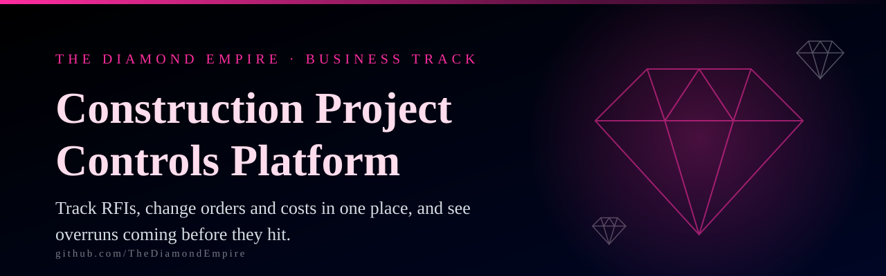

# Construction Project Controls Platform: Client Case Study

> Earlier warning on cost and schedule, fewer disputes and faster decisions.

> **Status of this document.** This is a reference case study: it sets out the business problem, the solution and the value model. The results table is intentionally blank and is filled in only from measured data (a pilot or a real engagement). No outcome figures are claimed here.
>
> **Status of the product.** The platform is a local prototype built on synthetic data; it has not been deployed or used on a real project. What was tested, and what was not, is in the [quality report](quality-report.md). Its outputs are planning aids, not engineering, legal or safety advice.

## Snapshot

|  |  |
|---|---|
| **Who it is for** | General contractors, construction managers and owner’s representatives running commercial or infrastructure projects. |
| **Solution** | Track RFIs, change orders and costs in one place, and see overruns coming before they hit. |
| **Track** | Business · Advanced |
| **Delivered by** | The Diamond Empire (https://thedempire.shop/) |

## The challenge

Information lives in inboxes and spreadsheets. Change-order exposure is discovered late, RFIs age without anyone noticing, and cost reports lag reality by weeks.

## The solution

A project-controls platform for general contractors and owner’s representatives. It connects RFIs, submittals, change orders, budgets, schedules and field logs, and forecasts cost and schedule at completion so teams can act while there is still room to recover.

What the client gets in practice:

- RFI and submittal tracking with ball-in-court status, due dates and aging reports
- Change-order pipeline from potential to approved, with cost and schedule impact
- Budget vs. committed vs. actual vs. forecast by cost code, with commitments from subcontracts and POs
- Pay-application preparation with retainage and stored-materials handling
- Offline-capable mobile daily logs with photos, weather and manpower records
- Schedule import (Primavera P6 XER and Microsoft Project XML) with critical-path risk flags
- Forecasting dashboards: cost performance, schedule performance and estimates at completion, each showing its method and drivers

## How it creates value

| Value lever | How the solution delivers it | How we measure it |
|---|---|---|
| Cost overruns | Exposure from pending changes and trends is visible while it can still be managed | Final cost vs. budget; forecast error at 50% complete |
| Decision speed | Ball-in-court tracking and aging reports cut waiting | Median RFI response time; change-order approval time |
| Cash flow | Accurate pay applications and committed-cost tracking | Days to submit pay applications; billing disputes |
| Dispute reduction | A dated record of changes, approvals and field conditions | Claims and disputed change orders |
| Admin time | One system replaces multiple trackers | Project-engineer hours per week on reporting |

## How an engagement runs

| Phase | What happens |
|---|---|
| Define | Cost structure, workflows and reporting needs |
| Pilot | One live project in parallel with current tools |
| Adopt | All active projects on the platform |
| Improve | Forecast tuning from completed projects |

## What the client receives

- Configured platform for the client’s project structure
- Cost-code and workflow templates
- Import of existing budgets and schedules
- Field mobile rollout and training
- Monthly forecast review format

## Results

Baseline measurements are taken **before** the solution goes live, and the same measures are taken after, so every change in the table is attributable and honest.

| Measure | How measured | Baseline | After | Change |
|---|---|---|---|---|
| Cost overruns | Final cost vs. budget; forecast error at 50% complete | — | — | — |
| Decision speed | Median RFI response time; change-order approval time | — | — | — |
| Cash flow | Days to submit pay applications; billing disputes | — | — | — |
| Dispute reduction | Claims and disputed change orders | — | — | — |
| Admin time | Project-engineer hours per week on reporting | — | — | — |

> **To fill in:** replace each — with measured values and add the measurement window and sample size beneath the table.

## How quality and risk are managed

- Property-based tests for cost roll-ups (sums reconcile at every level of the cost structure)
- Offline sync conflict tests across devices and clock skew
- Import tests against hand-written XER and Microsoft Project XML samples (no real exports were available, so fidelity on real files is untested)
- Role and permission tests across owner, contractor and subcontractor boundaries

## Is this a fit?

Best suited to: general contractors, construction managers and owner’s representatives running commercial or infrastructure projects.

## Talk to us

Want this adapted to your business? Get in touch via **[thedempire.shop](https://thedempire.shop/)**.

---

[README](../README.md) · [Client case study](case-study.md) · [Research report](research-report.md) · [Quality report](quality-report.md)
