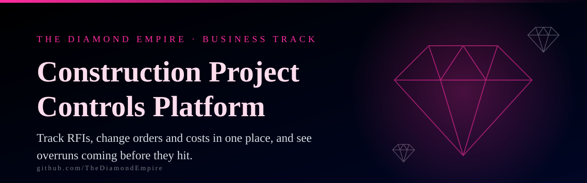

# Worked examples (hand-computed)

> Every calculation in the product that produces a schedule, cost or forecast figure is checked against one of the hand-worked examples below. Each section names the test that asserts the same numbers. The arithmetic was done by hand first; where a test found a slip in the hand arithmetic, the slip is recorded in the [quality report](quality-report.md) change log.
>
> These are planning aids, not engineering, legal or safety advice. The examples use invented numbers.

## 1. Cost roll-up and forecast per cost code

Test: `tests/costs.test.ts`. Rule for one leaf cost code: known cost = max(committed, actual); cost of work = max(revised budget, known cost) unless the project manager has entered an override (never below actual); forecast = cost of work + weighted pending change-order exposure; variance = revised budget - forecast.

| Leaf | Original | Changes | Revised | Committed | Actual | Exposure (raw / weighted) | Cost of work | Forecast | Variance |
|---|---|---|---|---|---|---|---|---|---|
| 01-100 | 100,000 | +10,000 | 110,000 | 95,000 | 60,000 | 20,000 / 5,000 | max(110,000, 95,000) = 110,000 | 115,000 | -5,000 |
| 01-200 | 50,000 | -10,000 | 40,000 | 45,000 | 45,000 | 0 / 0 | max(40,000, 45,000) = 45,000 | 45,000 | -5,000 |
| 03-100 | 200,000 | 0 | 200,000 | 150,000 | 100,000 | 40,000 / 30,000 | 200,000 | 230,000 | -30,000 |

Summary code `01` is the sum of `01-100` and `01-200`: revised 150,000, committed 140,000, actual 105,000, forecast 160,000, variance -10,000. Project total: revised 350,000, forecast 390,000, variance -40,000. With a manager override of 180,000 on `03-100` the forecast of that code becomes 180,000 + 30,000 = 210,000.

Change-order weights are illustrative defaults (potential 25%, pricing 50%, submitted 75%), not calibrated to any data: 10,000 of potential exposure counts as 2,500.

## 2. Pay application: retainage and stored materials

Test: `tests/payapp.test.ts`. Schedule of values: item 1 = 100,000, item 2 = 200,000. Retainage 10% on work and 10% on stored materials, rounded half away from zero per line.

Application 1: work this period 30,000 and 50,000; materials stored 0 and 10,000.

- G (completed and stored) = 30,000 and 50,000 + 10,000 = 60,000; total 90,000
- retainage: 10% x 30,000 = 3,000; 10% x 50,000 + 10% x 10,000 = 6,000; total 9,000
- earned less retainage = 90,000 - 9,000 = 81,000; previous payments 0; current payment due 81,000
- balance to finish including retainage = 300,000 - 81,000 = 219,000

Application 2: work this period 20,000 and 40,000; stored balance at period end 0 and 5,000 (5,000 of the stored material was installed, which is counted in the work, not twice).

- item 1: D 30,000 + E 20,000 = 50,000; retainage 5,000
- item 2: D 50,000 + E 40,000 + F 5,000 = 95,000; retainage 10% x 90,000 + 10% x 5,000 = 9,500
- total completed 145,000; retainage 14,500; earned less retainage 130,500; less previous 81,000; current payment due 49,500; balance to finish 300,000 - 130,500 = 169,500

Rounding: 5% of 12,350 cents = 617.5, which rounds to 618; 5% of 12,345 = 617.25, which rounds to 617.

## 3. Critical path method

Test: `tests/cpm.test.ts`. Time is whole working days; an activity occupies [ES, EF). FS: ES(s) >= EF(p) + lag; SS: ES(s) >= ES(p) + lag; FF: EF(s) >= EF(p) + lag; SF: EF(s) >= ES(p) + lag.

### 3a. Diamond network

A(3) -> B(4) -> D(5) and A -> C(2) -> D, all finish-to-start, no lag.

- forward: A 0-3, B 3-7, C 3-5, D 7-12. Project duration 12.
- backward: D LF 12, LS 7; B LS 3; C LF 7, LS 5; A LS 0.
- total float: A 0, B 0, D 0, C = LS 5 - ES 3 = 2; free float of C = ES(D) 7 - EF(C) 5 = 2. Critical path A, B, D.

### 3b. SS, FF and SF with lags

- SS lag 4: P(10), S(3): ES(S) = 4, EF 7; project 10; float of S = 3, of P = 0.
- FF lag 2: P(10), F(3): EF(F) >= 12, so ES(F) = 9; project 12; both critical.
- SF lag 8: P(5), S(3): EF(S) >= 8, so ES(S) = 5; project 8; P critical (LS 0).

### 3c. The synthetic sample network (14 activities, used by the demo and the importer tests)

Activities A100 to A230 with FS links plus one SS (+10) from A140 to A160, one SS (+5) from A160 to A170 and one FF from A230 to A220. The hand-computed table (days) is in `src/sample-data.ts` as `SAMPLE_EXPECTED` and is asserted for every activity. Project duration 94. Critical: A100, A110, A120, A130, A140, A160, A170, A180, A190, A210, A220. Non-critical: A150 (total float 38), A200 (2), A230 (49). For example A150: ES = 48 (finish of A140), EF = 51; successor A210 has LS 89, so LF = 89, LS = 86 and float 86 - 48 = 38.

## 4. Earned-value metrics and estimates at completion

Test: `tests/evm.test.ts`. BAC 1,000,000; PV 400,000; EV 350,000; AC 420,000.

- CV = EV - AC = -70,000; SV = EV - PV = -50,000
- CPI = 350,000 / 420,000 = 0.8333; SPI = 350,000 / 400,000 = 0.875
- EAC (CPI) = BAC / CPI = 1,200,000; ETC = 780,000; VAC = -200,000
- EAC (atypical variance) = 420,000 + (1,000,000 - 350,000) = 1,070,000
- EAC (CPI x SPI) = 420,000 + 650,000 / (0.8333 x 0.875) = 420,000 + 891,428.57 = 1,311,428.57
- TCPI to BAC = 650,000 / (1,000,000 - 420,000) = 1.1207

## 5. Earned schedule

Test: `tests/evm.test.ts`. Planned cumulative value (percent of BAC) at months 0 to 8: 0, 5, 15, 30, 50, 70, 85, 95, 100. Planned duration PD = 8.

At actual time AT = 4 with EV = 27%: EV lies between PV(2) = 15 and PV(3) = 30, so ES = 2 + (27 - 15) / (30 - 15) = 2.8. SV(t) = ES - AT = -1.2; SPI(t) = 2.8 / 4 = 0.7; independent estimate of duration PD / SPI(t) = 8 / 0.7 = 11.43. The traditional cost-based SPI is 27 / PV(4) = 27 / 50 = 0.54, giving 14.81.

Late in the project the two diverge: at AT = 8 with EV = 95%, ES = 7 (PV(7) = 95), SPI(t) = 0.875 and the estimate is 9.14; the cost-based SPI is 0.95 and gives 8.42, drifting toward the plan because cumulative PV flattens to 100% at the planned end.

## 6. Aging report

Test: `tests/workflow.test.ts`. As of 2026-06-15, open RFIs: #1 sent 2026-06-01, due 2026-06-08 (age 14 days, 7 overdue); #2 sent 2026-06-12, due 2026-06-19 (age 3, not overdue); #3 sent 2026-05-01, due 2026-05-08 (age 45, 38 overdue). Buckets: 0-7 days: 1; 8-14: 1; 15-30: 0; 31+: 1. Overdue: 2. Ordered most overdue first: #3, #1, #2. Median of response times 5, 1 and 9 days = 5; of 2 and 8 days = 5.

## 7. The seeded cost report

Test: `tests/api-cost.test.ts`. The demo project's totals, in cents:

- original budget 440,000,000 plus approved change order #1 (+4,800,000 on 03-200) = revised 444,800,000
- committed 87,500,000 + 88,000,000 + 108,500,000 = 284,000,000; actual 121,500,000
- pending change orders: #2 potential 9,000,000 (26-200: 7,200,000 and 26-100: 1,800,000) x 25%; #3 submitted 3,500,000 on 03-100 x 75% = 2,625,000; #4 pricing 2,200,000 on 09-100 x 50% = 1,100,000. Raw 14,700,000, weighted 1,800,000 + 450,000 + 2,625,000 + 1,100,000 = 5,975,000.
- forecast = revised budget + weighted exposure = 450,775,000, plus 1,500,000 because code 26-200 has 39,500,000 committed against a 38,000,000 budget (known cost exceeds budget): 452,275,000. Variance = 444,800,000 - 452,275,000 = -7,475,000.

(The first hand calculation of this example missed the 26-200 overrun and gave 450,775,000; the test caught it. See the change log in the quality report.)

## 8. Editing the seeded draft pay application

Test: `tests/api-workflow.test.ts`. Schedule of values (dollars): item 1 600,000; item 2 950,000; item 3 1,000,000 (the database stores cents). Application 1 is certified: work 150,000 / 400,000 / 0 and 80,000 stored on item 3 (steel). G = 150,000 + 400,000 + 80,000 = 630,000, retainage 63,000, payment due 567,000.

Draft application 2 is edited to work this period 100,000 / 200,000 / 50,000 and stored 0 / 0 / 30,000: item 1 G = 250,000 (retainage 25,000); item 2 G = 600,000 (60,000); item 3 G = 50,000 + 30,000 = 80,000 (retainage 5,000 + 3,000 = 8,000). Total G 930,000; retainage 93,000; earned less retainage 837,000; less previous 567,000; current payment due 270,000.

## 9. Forecast at the seeded status date

Test: `tests/api-schedule.test.ts`. Revised BAC 444,800,000 cents. Earned value uses each leaf code's revised budget times its reported percent complete: 01-100 40% of 42,000,000 = 16,800,000; 01-200 60% of 18,000,000 = 10,800,000; 03-100 100% of 35,000,000 = 35,000,000; 03-200 60% of 56,800,000 = 34,080,000; 05-100 20% of 90,000,000 = 18,000,000; 26-100 5% of 70,000,000 = 3,500,000. EV = 118,180,000. AC = 121,500,000. CPI = 0.9727.

Planned value: planned duration 143 days (project end plus 3 approved days); 56 days elapsed; the S-curve fraction is 3x^2 - 2x^3 at x = 56/143 = 0.3916, which is 0.33996, rounded to 34.00% of BAC: PV = 151,232,000. SPI = 118,180,000 / 151,232,000 = 0.7814.

Earned schedule: EV is 26.57% of BAC; solving 3x^2 - 2x^3 = 0.26569 gives x = 0.3381, so ES = 0.3381 x 143 = 48.35 days; SPI(t) = 48.35 / 56 = 0.8634; independent duration estimate 143 / 0.8634 = 165.6 days.
